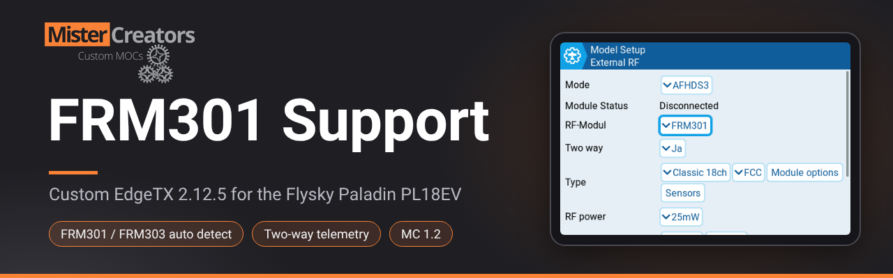

# EdgeTX 2.12.5 – FRM301 Support for Flysky Paladin PL18EV

**Firmware MC 1.2** · based on EdgeTX 2.12.5 · made by **MisterCreators Custom MOCs** ([mistercreator.de](https://mistercreator.de))

This package adds support for the **FlySky FRM301** RF module (the module that ships with the
Paladin PL18EV) to EdgeTX 2.12.5. The FRM301 is used as an external **AFHDS3** module, just like
the FRM303. Binding, two-way telemetry, channel output and automatic reconnect after a restart
all work, and the receiver ID is stored in the model file.

On top of that, the package fixes the 3-state stick buttons (EXT3/EXT4), brings a charging logic
modelled on FlySkyOS and comes as a ready-to-flash firmware file: **MC 1.2**.

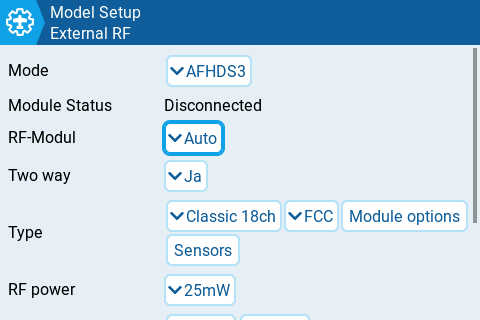

> **Coming to official EdgeTX:** these changes are being prepared as pull requests for the
> official EdgeTX `main` branch (upcoming version 3.0). The versions for `main` are in the folder
> `patches-main/`. Once they are merged, you won't need this package any more. Until then, it is
> the way to use the FRM301 with EdgeTX 2.12.5.

## Features

- **FRM301 support:** the FRM301 works as an external AFHDS3 module: bind, telemetry, channels.
- **Auto detection:** the new **RF-Modul** setting (*Auto* / *FRM303* / *FRM301*) recognises by
  itself which module is in the module bay. The FRM303 keeps working exactly as before.
- **Two-way telemetry:** switch it on or off per model with **Two way**.
- **Automatic reconnect:** receiver ID and module options are saved in the model, so the receiver
  connects again by itself after switching the radio off and on.
- **Receiver options:** bus type (e.g. SBUS) and PWM are set on the radio and sent to the module.
- **Stick buttons EXT3/EXT4:** the buttons on top of the sticks give clean values: rest 0 %,
  up +100 %, down −100 %. No Lua mixer script needed any more.
- **Charging like FlySkyOS:** charge screen with battery voltage and percent, LED bar, USB and
  wireless charging, no low-battery warning while a charger is connected.
- **Internal module on the Bluetooth port:** CRSF (e.g. the MC Brick Bridge) or MULTI
  (4in1 multiprotocol module), selectable in the hardware settings, power switched by the
  firmware.
- **New Lua functions:** `usbConnected()` and `getChargeState()`.
- **Version page** shows *MC 1.2 (based on EdgeTX 2.12.5)*. Companion and the SD card check keep
  working.

## Contents of this folder

| File / folder | Description |
|---------------|-------------|
| `EdgeTX-2.12.5-PL18EV-MC1.2.bin` | Ready-to-flash firmware **MC 1.2** for the Paladin PL18EV, contains all patches below |
| `patches/01-pl18ev-mc-custom.patch` | Base of the MC build: internal Crossfire on the Bluetooth port, Lua `usbConnected()` / `getChargeState()`, charge screen, version display |
| `patches/02-pl18ev-frm301.patch` | **FRM301 support** as an external AFHDS3 module |
| `patches/03-pl18ev-stickbuttons.patch` | Stick buttons EXT3/EXT4: rest 0 %, up +100 %, down −100 % |
| `patches/04-pl18ev-charging.patch` | Charging logic as in FlySkyOS (charge screen while the radio is off) |
| `patches-main/` | FRM301, stick buttons, internal module and charging as clean commits for EdgeTX `main` (3.0), for the pull request |

## Requirements

- A **Flysky Paladin PL18EV**.
- An **FRM301** (or FRM303) in the module bay.
- An **AFHDS3 receiver**. Tested with the **FTr16S**.
- A PC with **Chrome or Edge** (for EdgeTX Buddy) and a USB cable.
- The battery fully charged.

## Installation – flashing MC 1.2 with EdgeTX Buddy

### Before you start

- **Charge the battery** fully.
- **Back up the SD card / internal storage**, at least the folders `MODELS`, `RADIO`, `SCRIPTS`
  and `WIDGETS`.
- **Still on FlySkyOS?** Back up the original FlySky firmware first. Follow the EdgeTX guide
  *"Flashing EdgeTX to Flysky PL18 or Paladin EV"*, section *"Backing up Flysky Bootloader"*
  (about 2 MB). **Without this backup you can't go back to FlySkyOS.**

### Flashing step by step

1. **Switch the radio off.**
2. On the left grip, pull off the rubber cover. Underneath are two buttons: **top = DFU**,
   bottom = emergency off.
3. Plug the USB cable into the radio only and lay the radio down flat.
4. **Hold the DFU button** and plug the other end of the cable into the PC, then let go. The
   radio now shows up as a DFU device (the display stays dark).
5. Open **https://buddy.edgetx.org** in **Chrome or Edge**.
6. Go to **Flash**. Instead of picking a version from the list, choose the **local firmware file**
   (file upload) and select `EdgeTX-2.12.5-PL18EV-MC1.2.bin`.
7. Click **Flash via USB**, pick the DFU device (**STM32 BOOTLOADER**) in the browser dialog and
   wait (about 2 minutes). **Don't unplug the cable while flashing.**
8. When Buddy says it's done, unplug the USB cable and briefly press the lower hidden button
   (this switches the radio off).
9. Switch the radio on as usual.

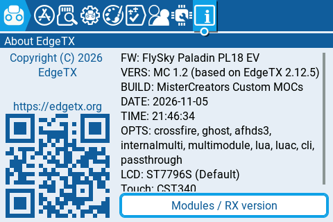

Under *Radio Setup → About EdgeTX* (the **i** tab) you now see
**"VERS: MC 1.2 (based on EdgeTX 2.12.5)"** and **"BUILD: MisterCreators Custom MOCs"**.

### Alternative: EdgeTX bootloader (no PC driver needed)
**WARNING:** this methode is known to bug sometimes, which causes the radio **[not starting after flashing](https://github.com/EdgeTX/edgetx/issues/7726)** (blackscreen), therefore flashing with edgeTX Buddy is recommended!!!

1. Copy the `.bin` file into the folder `FIRMWARE` on the SD card / internal storage.
2. Switch the radio off.
3. Push **both horizontal trims (TR7 and TR8) towards each other** and press **both power
   buttons**.
4. In the bootloader choose **Write Firmware** and select the file.

### Updating from MC 1.0 or MC 1.1

Simply flash MC 1.2 over it. Models and settings are kept, and the FRM301 doesn't need to be
bound again.

### Going back

To return to the official EdgeTX, flash an official release with EdgeTX Buddy in the same way.
The FRM301 only works with this build (until the pull requests are merged). To return to
FlySkyOS you need the backup of the original FlySky firmware (see *Before you start*).

## How to use

### 1. Set up the external module

<p>
  
  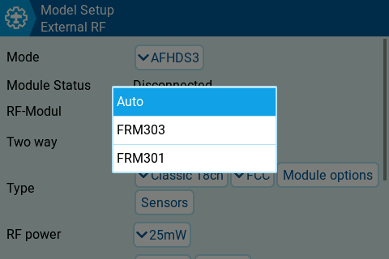
  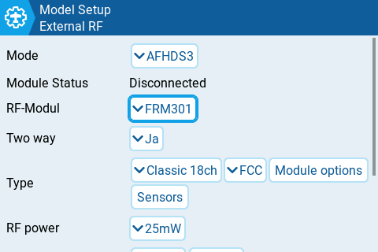
</p>

1. Open *Model Setup → External RF* and set **Mode** to **AFHDS3**.
2. Leave **RF-Modul** on **Auto**. The radio detects by itself whether an FRM301 or an FRM303 is
   in the bay. If you only ever use one module, you can also select **FRM301** or **FRM303**
   directly.
3. Set **Two way** to **Ja** (yes) if you want telemetry. With **Nein (One way)** the receiver is
   bound without a return channel.
4. **Type** (e.g. *Classic 18ch*, *FCC*) and **RF power** work as with the FRM303.
5. **Module Status** shows the current state of the module and the receiver (e.g.
   *Disconnected* before binding).

> The labels **RF-Modul**, **Two way**, **Ja** and **Nein** of the new settings are currently in
> German, all other labels come from EdgeTX as usual.

### 2. Bind the receiver

1. Put the receiver into bind mode.
2. Scroll down to the receiver and tap **Bind**. The radio restarts the module briefly.
   **This is intended.**
3. The module LED blinks green quickly and the receiver connects. **Module Status** changes to
   **Connected**.

That's it: the receiver ID is saved in the model. After switching the radio off and on, the
receiver connects again by itself. Bind again only if you change the receiver.

### 3. Module options

<p>
  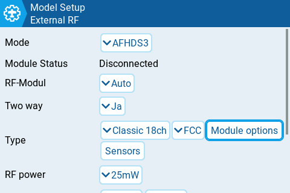
  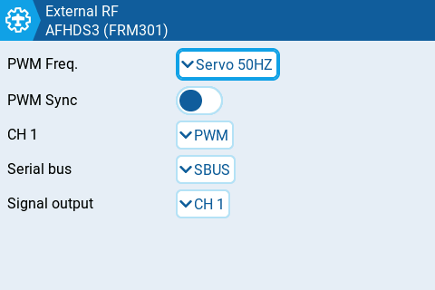
</p>

Tap **Module options** in the **Type** row. The title shows **AFHDS3 (FRM301)**, so you can also
see here which module was detected. Settings:

| Setting | Example | Description |
|---------|---------|-------------|
| **PWM Freq.** | Servo 50HZ | PWM frequency of the receiver outputs |
| **PWM Sync** | off | Synchronous PWM output |
| **CH 1** | PWM | Output mode of the receiver channel |
| **Serial bus** | SBUS | Bus type of the serial output (e.g. SBUS or iBUS) |
| **Signal output** | CH 1 | Channel the signal strength is sent to |

The values are saved in the model and sent to the module. **Sensors** next to it opens the
telemetry sensors of the receiver.

### 4. Using an FRM303

Nothing changes for the FRM303. With **RF-Modul** on *Auto* it is detected automatically, so you
can swap modules without changing the model settings.

### 5. Stick buttons (EXT3 / EXT4)

The buttons on top of the sticks are 3-position buttons. With MC 1.2 they give:

| Button | Value |
|--------|-------|
| not pressed | 0 % |
| pressed up | +100 % |
| pressed down | −100 % |

<p>
  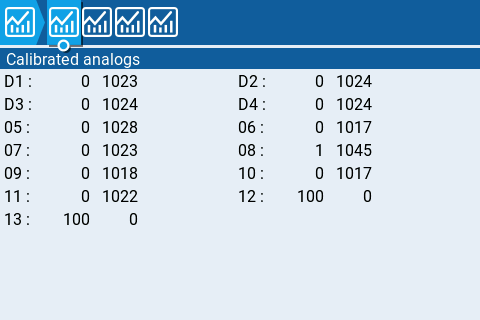
  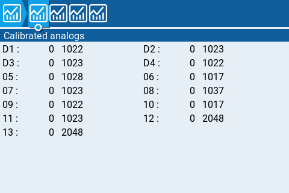
  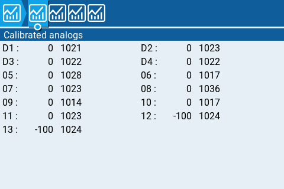
</p>

The screenshots show *Radio Setup → Hardware → Calibrated analogs* with both stick buttons
(entries **12** and **13**) pressed up (+100), not pressed (0) and pressed down (−100).

**Calibrate them once:** *System → Hardware → Calibration*, and press each button once up and
once down during the calibration. If a model still uses the Lua mixer script `btn3p.lua`,
remove it from that model, otherwise the value is converted twice.

You can then use EXT3 and EXT4 as a source anywhere in EdgeTX, e.g. in mixes or logical switches.

### 6. Charging


<p>
  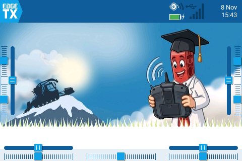
  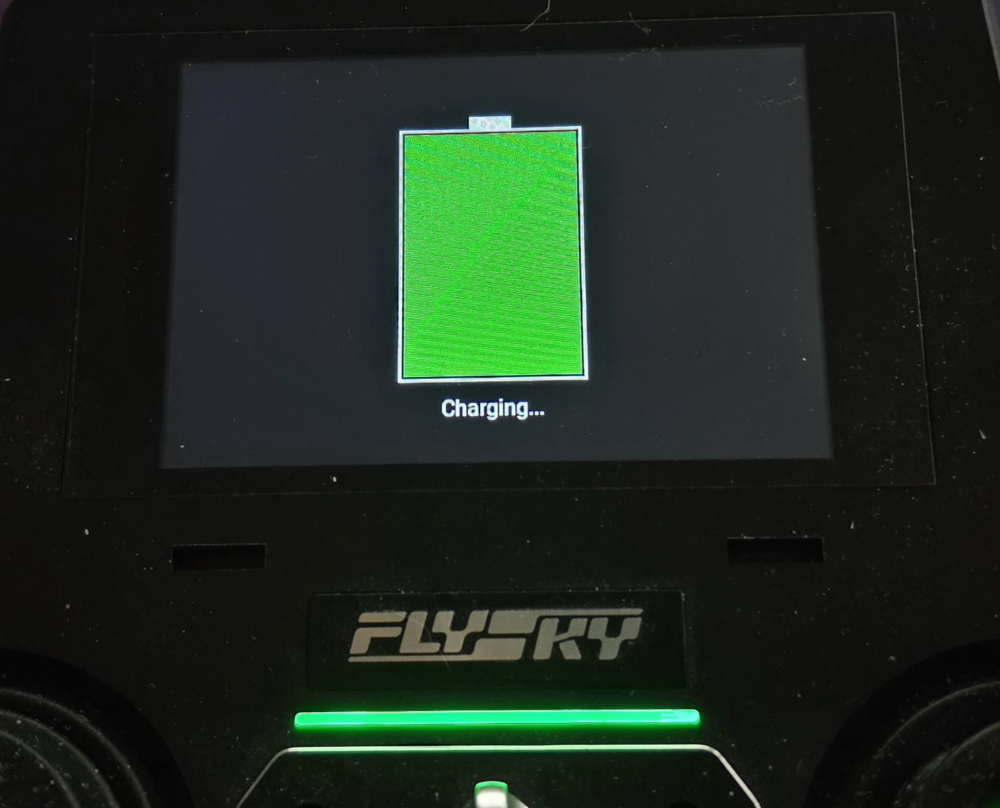
</p>

- **Radio switched on:** the radio charges and shows it in the top bar: the **USB symbol** and
  the **battery with a charging flash**.
- **Radio switched off:** plug in a USB charger or put the radio on a wireless charger. The
  charge screen shows the battery voltage and the charge level in percent, the LED bar
  shows the same fill.
- The screen stays on for **30 s** after plugging in and for **10 s** after touching the
  screen, moving a trim or pressing power.
- **Full** is only shown when the battery has really reached at least 4.15 V, and stays until
  you unplug the charger.
- Only one charger is active at a time. **USB has priority** over wireless.
- As long as a charger is connected, there is **no low-battery warning**.

**Status:** the charging logic is still being tested. Feedback on how it behaves on your charger
is welcome.

### 7. Internal module on the Bluetooth port (CRSF or Multi)

MC builds route the internal module to the Bluetooth port of the Paladin. This is used by the
**MC Brick Bridge** (BuWizz, SBrick, LEGO hubs), but any **CRSF** module or a **4in1
multiprotocol module (MULTI)** works.

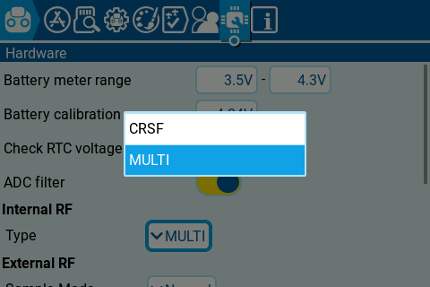

1. Connect the module to the Bluetooth port (TX, RX, GND).
2. Open *Radio Setup → Hardware* and choose the **Internal RF → Type**: **CRSF** or **MULTI**.
3. Open *Model Setup → Internal RF* and set **Mode** to the type you chose.

<p>
  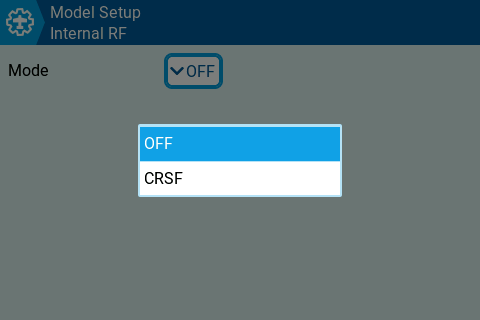
  
</p>

The model menu only offers the type that is selected in the hardware settings: **OFF / CRSF** or
**OFF / MULTI**.

The firmware switches the power of the internal module on and off. The external module bay with
the FRM301 is not affected and can be used at the same time.

### 8. Lua functions

Two new functions for your own scripts and widgets:

| Function | Returns |
|----------|---------|
| `usbConnected()` | `plugged` (boolean): USB power present (PC, charger, power bank) · `mode` (number): selected USB mode, 0 = not selected yet, 1 = joystick, 2 = mass storage, 3 = serial |
| `getChargeState()` | `state` (number): 0 = no charger, 1 = charging, 2 = full · `source` (number): 0 = none, 1 = USB, 2 = wireless |

```lua
local plugged, mode = usbConnected()
local state, source = getChargeState()
if state == 1 then
  lcd.drawText(10, 10, source == 1 and "Charging (USB)" or "Charging (wireless)")
end
```

## Troubleshooting

| Problem | Solution |
|---------|----------|
| Module isn't detected | Check that **Mode** is **AFHDS3**. The title of **Module options** shows which module was detected. Set **RF-Modul** to **FRM301** instead of *Auto*. |
| No telemetry | Set **Two way** to **Ja** and bind again. |
| Bind doesn't finish | Is the receiver really in bind mode? The short module restart after tapping **Bind** is normal. Tap **Bind** again if needed. |
| Receiver doesn't reconnect after a restart | Bind once more with MC 1.2, the receiver ID is then saved in the model. |
| Stick buttons give odd values | Check them under *Hardware → Calibrated analogs*, calibrate them (see above) and remove `btn3p.lua` from the model. |
| Storage warnings after a detour to FlySkyOS | Back up the SD card / internal storage and format it, then copy your files back. |
| *About EdgeTX* doesn't show MC 1.2 | The flash didn't finish. Flash again and don't unplug the cable during flashing. |

Always test range and failsafe before flying or driving.

## Building from source

The patches in `patches/` apply to **EdgeTX v2.12.5** and are applied in numeric order. 02 and 04
need 01. 03 (stick buttons) also works alone on an unchanged 2.12.5.

```
git clone --recursive -b v2.12.5 https://github.com/EdgeTX/edgetx.git
cd edgetx
git apply ../patches/01-pl18ev-mc-custom.patch
git apply ../patches/02-pl18ev-frm301.patch
git apply ../patches/03-pl18ev-stickbuttons.patch
git apply ../patches/04-pl18ev-charging.patch
mkdir build && cd build
cmake -DPCB=PL18 -DPCBREV=PL18EV -DPL18EV_INTERNAL_CRSF=ON -DMC_VERSION=1.2 -DCMAKE_BUILD_TYPE=Release ..
make firmware
```

Tested with arm-none-eabi-gcc 14.2.1 (xPack). The YAML tables need Python with `clang`
(libclang 18) and `asciitree`.

### Build options

| Option | Default | Description |
|--------|---------|-------------|
| `PL18EV_INTERNAL_CRSF` | `OFF` | Internal module (CRSF or MULTI) on the Bluetooth pads (USART3). Turns on the MC build (`MC_CUSTOM_BUILD`) |
| `PL18EV_INTMODULE_PWR_PI8` | `ON` | Switch the power of the internal module via PI.08 (BT_EN) |
| `MC_VERSION` | `1.0` | Version shown on the version page, e.g. `1.2` |
| `MC_CHARGE_DIAG` | `OFF` | Charger diagnostics on the charge screen and the version page |
| `PL18EV_FRM301` | `ON` | FRM301 as external AFHDS3 module (auto detect) |

## Changes in detail

### 01 – MC base (`pl18ev-mc-custom.patch`)

Only active with `-DPL18EV_INTERNAL_CRSF=ON`, which defines `MC_CUSTOM_BUILD`.

| File | Change |
|------|--------|
| `targets/pl18/CMakeLists.txt` | New options `PL18EV_INTERNAL_CRSF` (internal CRSF module on the Bluetooth pads, USART3), `PL18EV_INTMODULE_PWR_PI8` (power of the internal module via PI.08/BT_EN), `MC_VERSION`, `MC_CHARGE_DIAG` (diagnostics, off by default) |
| `targets/pl18/hal.h`, `board.h` | Internal module on TX3/RX3 (USART3), on/off via PI.08. UART7 stays free. |
| `targets/pl18/battery_driver.cpp/.h` | Charge screen with battery voltage and percent, LED bar, shown for 10 s after touch/trim/power or 30 s after plugging in, charging also while the radio is running (`mcChargeTick`), queries `mcChargerConnected` / `mcGetChargeState` / `mcGetChargeSource` |
| `targets/pl18/board.cpp` | Charge screen: loads ADC and battery calibration, trims and a real touch contact (checked 3× via I2C) wake up the display |
| `targets/pl18/touch_driver.cpp/.h` | `mcTouchHasContact()`: reads directly whether a finger is on the screen (the INT pin also pulses while charging without a touch) |
| `edgetx.cpp` | Calls `mcChargeTick()` every 10 ms (charge state while the radio is running) |
| `main.cpp` | No battery warning as long as a charger is connected |
| `lua/api_general.cpp` | New Lua functions `usbConnected()` and `getChargeState()` (state 0/1/2 and source USB/wireless) |
| `gui/colorlcd/radio/radio_version.cpp` | Version page shows "FW: FlySky Paladin PL18 EV / VERS: MC x.y (based on EdgeTX …)". The internal version stamps stay unchanged, so Companion and the SD card check keep working. |

### 02 – FRM301 (`pl18ev-frm301.patch`)

Option `PL18EV_FRM301` (default: on) defines `AFHDS3_FRM301_EXT`. The FRM301 sits on the same
port as the FRM303. The FRM303 keeps working unchanged.

| File | Change |
|------|--------|
| `pulses/afhds3.cpp` | FRM301 support: automatic detection FRM301/FRM303, binding, channel data, telemetry, saving and restoring the receiver data and module options in the model |
| `pulses/afhds3_transport.cpp/.h` | Transport changes needed for the FRM301 |
| `pulses/afhds3_config.h`, `afhds3_module.h` | `isFRM301()`, larger send buffer |
| `pulses/pulses.h`, `telemetry/telemetry.h` | Larger buffers |
| `gui/colorlcd/module/afhds3_settings.cpp` | Settings **RF-Modul** (Auto/FRM303/FRM301) and **Two way** (Nein/Ja) |
| `gui/colorlcd/module/afhds3_options.cpp` | Title shows FRM301 or FRM303 |
| `main.cpp` | Saving to the model runs in the UI task (`afhds3::frmBackgroundTask()`) |
| `datastructs_private.h`, `datastructs.h` | New model fields `frm301Rx` (receiver data) and `frm301Cfg` (module options), CHKSIZE adjusted |
| `storage/yaml/yaml_datastructs_pl18.cpp` | YAML entries for the new fields |
| `storage/yaml/yaml_tree_walker.cpp` | `copy_string`: length parameter from `uint8_t` to `uint16_t`, otherwise strings longer than 255 characters are cut off |
| `targets/pl18/CMakeLists.txt` | Option `PL18EV_FRM301` |

Debug code is included but only compiled with `-DFRM301_DEBUG`. In the version for `main` it is
removed completely, and the built-in `userData` storage is used there instead of new model fields.

### 03 – Stick buttons (`pl18ev-stickbuttons.patch`)

| File | Change |
|------|--------|
| `mixer.cpp` | The buttons on top of the sticks (EXT3/EXT4) are 3-position resistor buttons. The calibrated value is converted: rest 0 %, up +100 %, down −100 %. With 50 ms debouncing, because on its way to "up" the signal briefly passes the "down" level. Replaces the Lua mixer script `btn3p.lua`. |
| `util/hw_defs/pot_config.py` | Default type of EXT3/EXT4 changed from `MULTIPOS` to `POT_CENTER` |

Important: calibrate the buttons once (*System → Hardware → Calibration*, press each button once
up and once down). Remove an existing `btn3p.lua` from the model afterwards, otherwise the value
is converted twice.

### 04 – Charging logic (`pl18ev-charging.patch`)

Modelled on FlySkyOS (Paladin EV firmware 1.0.9, charge task every 100 ms):

| File | Change |
|------|--------|
| `targets/pl18/battery_driver.cpp` | The charge pin (USB PB13, wireless PI10) only counts after 1 s at the same level. "Full" only when the pin reports end of charge **and** the battery voltage (5 samples averaged without min/max) is at least 4.15 V. Once "full", it stays full until the charger is unplugged. The charger chip is switched on for 97 s and off for 3 s (restarts the charge cycle, the pin is ignored during the pause). Only one charger is active at a time, USB has priority. The wireless charge current is raised after 240 s and lowered again 60 s after taking the radio off the charger. |

**Status:** still being tested. Feedback on how it behaves on the charging cable is welcome.

## Tested with

| | |
|---|---|
| Radio | Flysky Paladin PL18EV |
| RF modules | FRM301, FRM303 |
| Receiver | FTr16S |
| Toolchain | arm-none-eabi-gcc 14.2.1 (xPack) |

## Screenshots

The screenshots were taken on a Paladin PL18EV running MC 1.2 with the default EdgeTX theme.
With another theme, colours may look different.

## Changelog

- **MC 1.2**: FRM301 support with auto detection FRM301/FRM303, two-way telemetry and automatic
  reconnect. Stick buttons EXT3/EXT4 with 0 / +100 / −100 %. Charging logic modelled on FlySkyOS.
  Can be flashed directly over MC 1.0 and MC 1.1.
- **MC 1.0**: first MC build: internal CRSF module on the Bluetooth port, Lua `usbConnected()` and
  `getChargeState()`, charge screen with voltage and percent, version display.

## Legal

EdgeTX is licensed under the GPLv2. The patches are released under the same licence. No FlySky
code is included. Use at your own risk. Always test range and failsafe before flying or driving.

## Credits

Made by **MisterCreators Custom MOCs** ([mistercreator.de](https://mistercreator.de)).
Based on [EdgeTX](https://github.com/EdgeTX/edgetx).
